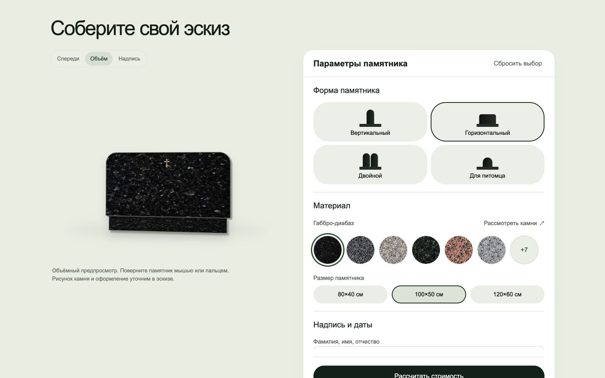

# Конструктор памятника

Статическая интерактивная страница на русском языке. Не требует сборки, сервера приложений или внешних библиотек.



## Запуск

Откройте `index.html` в современном браузере. Для локального HTTP-просмотра из этой папки можно запустить:

```sh
python3 -m http.server 8000
```

Затем перейдите на `http://localhost:8000`.

## Состав

- `index.html` — страница, стили, интерактивный конструктор и локальное демо формы.
- `assets/stone-texture-atlas.png` — текстуры камня.
- `assets/accessory-atlas.png` — изображения дополнительных элементов.
- `preview.png` — снимок стартового экрана для просмотра в репозитории.

Сохраните всю папку целиком: HTML использует относительные пути `assets/...`. Форма обращения работает как демонстрация и ничего не отправляет на сервер.
Изображения материалов и дополнений иллюстративные; для каталога реальных изделий замените их проверенными образцами.

## GitHub Pages

Для публикации разместите эти файлы в корне репозитория и включите Pages для ветки/папки корня в настройках репозитория. Страница не требует шага сборки.
